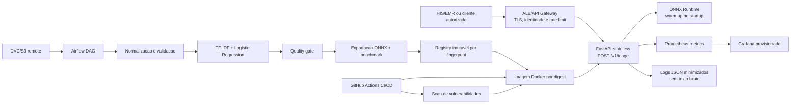

# Sistema de Triagem Automatica de Laudos

<p align="center">
  
  
  
  
  
  
  
</p>

<p align="center">
  <a href="https://github.com/ebianchini/tech-challenge-fase-3/actions/workflows/ci.yml">
    
  </a>
  
  
  
</p>

Projeto iniciado conforme o SDD de apoio. Esta entrega cobre a fundacao das Etapas 0 e 1: governanca
documentada, API FastAPI, contrato versionado, carregamento singleton no startup, health checks,
abstencao tecnica, container multi-stage e testes do dominio e da API. A Etapa 2 inclui o pipeline
offline, DVC, DAG Airflow e as configuracoes de CI e CD descritas abaixo. A Etapa 3 adiciona
instrumentacao da API, exposicao de metricas em `GET /metrics`, servidor Prometheus local com
coleta, alertas e retencao, dashboard Grafana provisionado por arquivos e logs JSON com
minimizacao de dados e rotacao.

O artefato de inferencia da API continua sendo uma demonstracao tecnica treinada com texto
sintetico. O corpus fornecido em `data/raw/medical_tc_train.csv` e o Medical Abstracts TC
Corpus, cujas classes sao tematicas (`condition_label`) e nao representam urgencia clinica.
Nenhum resultado atual deve ser interpretado como evidencia de seguranca ou desempenho clinico.

## Execucao local

Requer Python 3.11-3.13 e `uv`.

```powershell
uv sync --locked --extra dev --extra airflow --python 3.12
uv run --no-sync python scripts/create_demo_model.py
uv run --no-sync python scripts/benchmark_baseline.py
uv run --no-sync python scripts/benchmark_comparison.py
uv run --no-sync pytest -q tests
uv run --no-sync uvicorn triage.api.app:app --host 0.0.0.0 --port 8000 --workers 1 --no-access-log --log-config logging/uvicorn.json
```

A API fica em `http://localhost:8000`. O contrato completo esta em
`docs/inference-contract.md`. Nenhum texto de entrada e escrito em logs ou metricas por esta etapa.
Os benchmarks geram `reports/latency_baseline.csv` e
`reports/latency_comparison.csv`. O comparativo mede cold start, inferencia individual e em
lote, p50/p95/p99, memoria residente/alocada e equivalencia de classes/probabilidades.

O arquivo `.env.example` lista somente configuracoes locais sem segredos. O ambiente de dependencias
e fixado por `pyproject.toml` e `uv.lock`.

`create_demo_model.py` tambem gera `models/triage.onnx` e `models/model_metadata.json`.
Em desenvolvimento, a API usa o sklearn como fallback para manter o fluxo local independente
do artefato otimizado. Em producao, o Dockerfile define
`TRIAGE_INFERENCE_BACKEND=onnx` e a readiness falha se o ONNX nao estiver disponivel.

## Decisoes de arquitetura

A solução foi organizada separando o caminho de inferência do caminho de treinamento. A API
FastAPI atende as requisições de forma síncrona e utiliza um modelo carregado no startup,
evitando recarregamentos a cada chamada. Para reduzir a latência, o backend de produção prioriza
o ONNX Runtime, enquanto o sklearn continua disponível como fallback para desenvolvimento e
comparação dos resultados.

O treinamento acontece de forma offline, sendo executado pelo pipeline versionado com DVC e
orquestrado pelo Airflow. Esse fluxo realiza a preparação dos dados, o treinamento, a avaliação,
a exportação para ONNX e o benchmark de latência. A promoção do modelo depende do quality gate e
do fingerprint dos artefatos, permitindo identificar exatamente qual versão foi utilizada.

Para a execução em produção, foi considerada uma arquitetura com Docker, ECR, ECS/Fargate e
ALB. O acesso externo deve passar por uma camada de gateway responsável por TLS, autenticação,
controle de tráfego e rate limiting. A aplicação permanece stateless, e as imagens devem ser
referenciadas por digest em vez de `latest`, facilitando auditoria e rollback.

A observabilidade foi separada da aplicação principal. A API expõe métricas no formato Prometheus,
o Grafana apresenta os principais indicadores operacionais e os logs são emitidos em JSON com
minimização de dados. Textos de entrada, tokens, headers e mensagens de exceção não são
registrados. O Compose local reproduz somente a parte necessária para desenvolvimento e testes,
não substituindo os controles de segurança e infraestrutura previstos para AWS.

Como o dataset disponibilizado possui classes temáticas e não rótulos de urgência, o modelo atual
é tratado como uma demonstração técnica. A promoção para uso clínico permanece bloqueada até que
exista um dataset aprovado, com `urgency_label`, validação por especialistas, avaliação clínica,
aprovações institucionais e controles formais de privacidade.

Detalhes operacionais: [docs/architecture.md](docs/architecture.md). Governanca: [docs/governance.md](docs/governance.md).
Anotacao clinica proposta: [docs/annotation-protocol.md](docs/annotation-protocol.md). Privacidade:
[docs/privacy-checklist.md](docs/privacy-checklist.md).

## Arquitetura



O diagrama representa a arquitetura alvo e os limites desta entrega: o Compose local substitui
ALB, AWS, S3 e observabilidade gerenciada somente para desenvolvimento. O corpus Medical
Abstracts TC permanece técnico e temático; promoção clínica exige `urgency_label`, quality gate
aprovado e aprovações institucionais.

## Docker

```powershell
docker build --build-arg TRIAGE_MODEL_SOURCE=demo -t triage-laudos:dev .
docker run --rm --log-driver json-file --log-opt max-size=10m --log-opt max-file=3 -p 127.0.0.1:8000:8000 triage-laudos:dev
# PowerShell: executa readiness e uma requisicao sintetica, removendo o container ao final
./scripts/docker_smoke.ps1
```

Endpoints: `GET /health/live`, `GET /health/ready`, `POST /v1/triage` e `GET /metrics`.

Para executar a stack local, use Docker com containers Linux e Compose v2:

```powershell
docker compose config --quiet
docker compose up -d --build --wait --wait-timeout 180
```

O build do Compose gera o modelo sintetico dentro da imagem, sem precisar de Python ou
artefatos preparados no host. O comando padrao inicia somente API, Prometheus e Grafana.
Airflow/Postgres ficam no perfil opcional `airflow`. Com as portas de `.env.example`, a API fica em
`http://127.0.0.1:8000`, o Prometheus em `http://127.0.0.1:9090` e o Grafana em
`http://127.0.0.1:3000`. No Grafana, entre com **`admin` / `triage-local-demo`**, credenciais
exclusivas desta demonstracao local, e abra **Dashboards > Triage > Triagem | operação do protótipo sintético**.
O datasource e o dashboard sao provisionados automaticamente, sem importacao manual.

A stack separa redes de coleta, acesso a API, observabilidade e Airflow; as portas do host
escutam somente em loopback. O historico Prometheus fica em `prometheus-data`, com retencao de 7 dias ou 1 GB,
conforme o primeiro limite atingido. Reserve pelo menos 2 GB para esse volume; o limite da TSDB
nao e uma quota rigida de disco. O Grafana persiste seu banco em `grafana-data`. Instrucoes de
operacao, perfil Airflow e validacao integrada estao em [docs/compose-local.md](docs/compose-local.md).
Coleta, alertas e dashboard estao em [docs/prometheus-local.md](docs/prometheus-local.md) e
[docs/grafana-local.md](docs/grafana-local.md). Para subir somente API e coletor, explicite
`api prometheus` no comando. A [captura do dashboard](docs/images/grafana-triage-overview.png) mostra os nove
paineis com trafego sintetico; a evidencia e os limites de validacao estao no guia Grafana.

Para executar o smoke completo em um projeto Compose temporario, com Docker ativo:

```powershell
uv sync --locked --extra dev
uv run --no-sync python scripts/check_compose.py --output reports/ci/compose-smoke.json
```

O script verifica API, scrape, datasource, dashboard e consultas; recria o Grafana para verificar
o provisionamento e a persistencia e remove somente os recursos do projeto temporario ao final.

## Pipeline de dados, modelo e DVC

O pipeline offline esta em [`src/triage/training/`](src/triage/training). O adaptador aceita
`text`/`abstract`/`report_text` e preserva o rótulo original em `label_original`; ele nunca
converte classes temáticas em urgência. O treino técnico é executado com:

```powershell
uv run train --data data/interim/medical_tc_train_normalized.csv --output-dir models/training
```

O modelo é `TfidfVectorizer -> LogisticRegression`, com o vocabulário ajustado somente no
conjunto de treino. São persistidos o pipeline completo, componentes compatíveis, split,
fingerprint, parâmetros, métricas por classe, matriz de confusão e erro de calibração.
`--clinical` exige uma coluna `urgency_label` e `--clinical-approval`; sem ambos o treino
clínico falha explicitamente.

O treino reproduzido pelo DVC sobre o corpus técnico gera cinco classes temáticas e, portanto,
não pode passar o gate de `recall_urgente` nem ser registrado como modelo clínico. O gate
reprovado nesse caso é intencional e impede promoção indevida.

O fluxo DVC em [`dvc.yaml`](dvc.yaml) normaliza o CSV e treina usando [`params.yaml`](params.yaml):

```powershell
$env:DVC_REMOTE_URL = "s3://bucket-privado/triage-dvc"
uv run dvc remote add --local -d default $env:DVC_REMOTE_URL
uv run dvc repro
uv run dvc pull
uv run dvc push
```

Configure permissões por identidade (por exemplo, OIDC/role na CI ou perfil local), nunca
credenciais no repositório. O arquivo [`.dvc/config.example`](.dvc/config.example) mostra o
formato; o remote efetivo deve ser gravado somente na configuração local (`--local`). O corpus
precisa ser fornecido por `dvc pull` ou colocado em `data/raw/`. Os arquivos
`medical_tc_train.csv`, `medical_tc_test.csv` e `medical_tc_labels.csv` são rastreados por DVC.
O estágio reprodutível usa o conjunto de treino técnico; o conjunto de teste permanece disponível
para avaliação externa e não é convertido em label de urgência.

Após a reprodução, `uv run dvc status --json` deve retornar `{}` e [dvc.lock](dvc.lock) deve
permanecer consistente com os arquivos de dados e os parâmetros.

## Airflow

A DAG [`dags/triage_retrain.py`](dags/triage_retrain.py) executa, em ordem,
`load_data`, `validate_data`, `prepare_splits`, `train_model`, `evaluate_model`, `export_onnx`,
`benchmark_latency` e `register_if_approved`. As tasks trocam somente manifestos e artefatos em
`TRIAGE_RUN_ROOT`; datasets e modelos não são enviados por XCom (`do_xcom_push=False`).

Instale as dependências da DAG com `uv sync --extra airflow` e aponte o Airflow para `dags/`.
O agendamento é manual por padrão; `TRIAGE_RETRAIN_SCHEDULE`, `TRIAGE_TASK_RETRIES`,
`TRIAGE_TASK_TIMEOUT_MINUTES`, `TRIAGE_DATA_PATH`, `TRIAGE_RUN_ROOT` e `TRIAGE_REGISTRY_ROOT`
permitem parametrizar o ambiente. O registro usa o fingerprint do artefato como diretório
imutável e só ocorre após o quality gate. Para modelo clínico, também exige
`TRIAGE_CLINICAL_APPROVAL=approved`. Para executar o Airflow pelo Compose, ative o perfil
`airflow` conforme [docs/compose-local.md](docs/compose-local.md#airflow-opcional); a configuracao
local nao concede aprovacao clinica automaticamente.

## Integracao continua

O workflow [`.github/workflows/ci.yml`](.github/workflows/ci.yml) executa em todo push e pull request,
com Python 3.12 e dependencias de `uv.lock`. Os jobs verificam Ruff, Pytest com cobertura, sintaxe e
carregamento da DAG pelo Airflow real, contrato OpenAPI contra um baseline versionado e configuracao
do Compose/Prometheus com testes das regras de alerta e smoke da stack com Grafana. O gate
final **`CI required`** exige sucesso de todas essas verificacoes.

A CI usa somente fixtures e modelos sinteticos, sem baixar datasets ou publicar modelos. Os uploads
sao limitados aos relatorios explicitamente listados no workflow. Comandos locais, artefatos,
atualizacao do contrato e passos para exigir o gate na branch estao em [docs/ci.md](docs/ci.md).

A CI publicada no commit `6f562a6` concluiu a stack e o check de dashboard no
[GitHub Actions](https://github.com/ebianchini/tech-challenge-fase-3/actions/runs/39865208559).
A reorganizacao atual do Compose e seu novo smoke precisam de uma execucao do commit atualizado;
a protecao de branch permanece uma configuracao remota separada.

## Entrega continua

O workflow [`.github/workflows/cd.yml`](.github/workflows/cd.yml) verifica a CI do commit exato da
`main`, constroi ou reutiliza sua imagem imutavel, executa smoke test e scan de vulnerabilidades,
publica no ECR via OIDC e atualiza um servico ECS/Fargate existente por digest. A implantacao
confere a revisao ativa, o JSON de readiness e o contrato HTTP; falhas restauram o digest anterior.

Os ambientes `dev`, `staging` e `production` possuem configuracoes separadas. O automatico em
`dev` depende da variavel de repositorio `CD_ENABLED=true`; os demais podem ser promovidos por
`workflow_dispatch`. Production exige uma tag de release do mesmo commit e deve ter aprovadores
configurados no GitHub Environment. Todas as imagens deste fluxo usam somente o modelo sintetico.

Configure os recursos AWS, roles e environments conforme [docs/cd.md](docs/cd.md); os templates
parametrizaveis estao em [`infra/aws/`](infra/aws/). Build e deploy reais ainda precisam ser validados
com Docker e com uma conta AWS configurada. A entrega local valida a automacao com testes HTTP e
simulacoes das respostas AWS, sem provisionar recursos.

## Metricas Prometheus

A API expoe `GET /metrics` no formato Prometheus. A instrumentacao registra requisicoes e latencia
HTTP, latencia de inferencia, predicoes por classe, erros por tipo seguro, abstencoes, readiness e
tamanho dos textos em caracteres. Os textos, identificadores de requisicao e caminhos desconhecidos
nao sao usados como labels. As consultas a `/metrics` nao alimentam as estatisticas HTTP.

Use um unico worker por container: o registro de metricas e isolado por instancia da aplicacao e
esta entrega nao agrega multiplos processos. O endpoint nao possui autenticacao na aplicacao;
restrinja seu acesso a rede de observabilidade e nao o inclua nas rotas publicas do gateway.

## Logs e privacidade

Cada requisicao gera um evento JSON em stdout com `request_id`, metodo, template da rota,
status HTTP, latencia e versao do modelo. Payloads, headers, tokens, URLs recebidas e mensagens
de excecao ficam fora do registro. Erros de validacao usam mensagens fixas e ocultam nomes
de campos extras. A configuracao versionada do Uvicorn tambem remove mensagens e stack traces
dos eventos de servidor e desativa o access log com URLs.

`X-Request-ID` usa um UUID canonico, gerado quando o header nao for seguro; o mesmo valor
aparece no header da resposta e no log, inclusive em erros. O `request_id` opcional no corpo
continua sendo devolvido pelo contrato, sem ser registrado. Sem ele, corpo, header e log
usam o mesmo UUID. A versao HTTP `1.0` e os schemas permanecem compativeis.

O Compose aplica rotacao `json-file` de 10 MB x 3 arquivos por container. A politica proposta
para CloudWatch e de 14 dias, com template e comandos de aplicacao pelo operador; nenhuma
configuracao AWS e alterada automaticamente. Operacao, testes e limites estao em
[docs/logging-privacy.md](docs/logging-privacy.md).

Consulte [docs/metrics.md](docs/metrics.md) para unidades, contagem de lotes, labels e limites; veja
[docs/prometheus-local.md](docs/prometheus-local.md) para coleta, alertas, retencao e verificacao
do servidor local. Os alertas ficam na UI/API do Prometheus, sem envio de notificacoes.
O dashboard Grafana inclui requisicoes, latencia, erros de triagem e HTTP 5xx, predicoes, abstencao e readiness;
veja [docs/grafana-local.md](docs/grafana-local.md) para consultas e verificacao do provisionamento.

## Validacao desta entrega

As verificacoes executadas com os arquivos disponibilizados em `data/raw/` foram:

- `uv run dvc repro`: aprovado; gerou [dvc.lock](dvc.lock) e `uv run dvc status --json` retornou `{}`.
- Fluxo das tasks de dados, treino, avaliacao, exportacao ONNX e benchmark: executado com
  `medical_tc_train.csv`; o registro foi bloqueado pelo quality gate, como esperado para classes
  tematicas sem `urgency_label`.
- Comparativo sklearn/ONNX: [reports/latency_comparison.csv](reports/latency_comparison.csv) e
  [reports/latency_comparison.json](reports/latency_comparison.json); delta maximo de
  probabilidade `4e-8`, classes equivalentes, tamanho de artefato e gate de speedup aprovados.
  O benchmark mede single/batch, cold start, p50, p95, p99, RSS residente e alocacao Python.

Resumo do benchmark local atual:

| Cenário | sklearn p95 | ONNX p95 | Speedup ONNX | Tamanho sklearn | Tamanho ONNX |
|---|---:|---:|---:|---:|---:|
| Instância única | 2,6771 ms | 0,1853 ms | 14,45x | 3.760 B | 3.108 B |
| Lote de 3 | 2,8221 ms | 0,3421 ms | 8,25x | 3.760 B | 3.108 B |
- `uv run pytest -q tests`: 284 testes aprovados.
- Ruff, validacao OpenAPI, carregamento da DAG e smoke Docker Compose: aprovados localmente.

Essas evidencias comprovam a cadeia tecnica local, mas nao substituem uma execucao Linux do
workflow no GitHub Actions, um deploy AWS real ou validacao clinica.

## Proximos bloqueios

Antes de qualquer uso hospitalar, ainda sao necessarios governanca clinica, dataset rotulado por
especialistas, desidentificacao aprovada, protecao de branch com CI obrigatoria, checklist de
seguranca aprovado, configuracao e validacao do deploy AWS e uma execucao Linux do workflow
atualizado no GitHub Actions. O corpus técnico continua bloqueado para promoção clínica.
