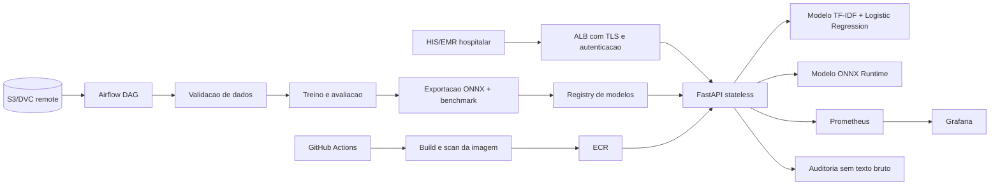
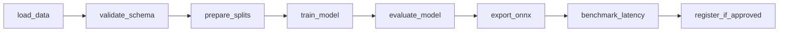

# SDD - Sistema de Triagem Automatica de Laudos

## 1. Status e objetivo

- **Status:** Etapas 0 e 1 tecnicamente implementadas; aprovacao humana ainda pendente
- **Escopo:** API REST de baixa latencia, pipeline de treinamento, retreinamento orquestrado, observabilidade e comparacao de inferencia otimizada
- **Classes de produto:** `normal`, `atencao`, `urgente`
- **Publico:** equipe de engenharia, MLOps, operacao de plataforma e especialistas clinicos
- **Restricao essencial:** o sistema e um apoio a triagem e nao substitui avaliacao medica, protocolo hospitalar ou decisao clinica

Este documento define as decisoes tecnicas e os contratos necessarios para construir o projeto em quatro etapas macro. Ele nao autoriza uso clinico autonomo.

### 1.1 Estado desta entrega

A fundacao da Etapa 1 esta implementada em `src/triage`: dominio sem dependencia de FastAPI, caso de
uso de triagem, carregador de artefatos scikit-learn e adaptador HTTP FastAPI. O modelo versionado no
repositorio e sintetico e existe somente para validar o caminho tecnico; rotulagem clinica, abstencao
validada clinicamente e uso hospitalar permanecem bloqueados.

O núcleo da Etapa 2 para dados, modelo e DVC está implementado em `src/triage/training`. O adaptador
normaliza o corpus para `text` e `label_original`, calcula fingerprint estável, valida nulos/classes
e impede treino clínico sem `urgency_label` e aprovação explícita. O pipeline `TfidfVectorizer ->
LogisticRegression` ajusta o vocabulário apenas no treino e persiste o pipeline, split, parâmetros,
métricas e gate de qualidade. `dvc.yaml` declara as etapas de normalização e treino; o remote deve
ser configurado localmente ou na CI com identidade segura, sem credenciais versionadas.

A CI da Etapa 2 esta implementada em `.github/workflows/ci.yml`, com Ruff, Pytest e cobertura,
validacao da DAG em Airflow real e contrato OpenAPI versionado. O workflow usa somente dados
sinteticos e publica uma lista explicita de relatorios tecnicos. A execucao no GitHub Actions e
a protecao de branch continuam pendentes de confirmacao remota; detalhes em `docs/ci.md`.

Os processos de governanca, anotacao, privacidade e decisoes operacionais estao documentados em
`docs/governance.md`, `docs/annotation-protocol.md`, `docs/privacy-checklist.md` e
`docs/architecture.md`. Esses documentos nao substituem as assinaturas e aprovacoes dos responsaveis.

## 2. Contexto e problema

O hospital deseja classificar laudos medicos textuais por prioridade operacional. A resposta precisa ser simples, auditavel e suficientemente rapida para integracao com sistemas hospitalares. O fluxo deve permitir:

1. receber um texto de laudo;
2. validar o contrato e rejeitar entradas invalidas;
3. retornar a classe de urgencia, probabilidades e versao do modelo;
4. registrar metricas tecnicas sem registrar texto sensivel;
5. treinar e publicar uma nova versao com rastreabilidade e rollback.

### 2.1 Limitacao do dataset informado

O **Medical Abstracts TC Corpus** e conhecido como corpus para classificacao tematica de abstracts medicos. Suas classes originais nao representam necessariamente `normal`, `atencao` e `urgente`. Portanto:

- o dataset pode ser usado para validar a cadeia tecnica de NLP, CI/CD, Airflow, observabilidade e latencia;
- ele nao pode, sem rotulagem adicional, validar a capacidade clinica de priorizar urgencia;
- a implementacao deve separar `label_original` de `urgency_label` e impedir que um resultado tematico seja apresentado como urgencia;
- antes de qualquer piloto hospitalar, deve existir um dataset institucional rotulado por especialistas, com protocolo de anotacao, concordancia entre avaliadores, desidentificacao e aprovacao de governanca;
- resultados no corpus publico devem ser reportados como **prova tecnica**, nunca como evidencia de seguranca clinica.

## 3. Requisitos

### 3.1 Requisitos funcionais

- API `POST /v1/triage` para uma ou mais solicitacoes de texto.
- API `GET /health/live` para liveness e `GET /health/ready` para readiness.
- API `GET /metrics` no formato Prometheus.
- Resposta contendo classe, probabilidades, versao do modelo, id de correlação e indicador de abstencao quando aplicavel.
- Pipeline de treino com leitura de dados, validacao, treino, avaliacao e persistencia de artefatos.
- DAG Airflow funcional para executar o pipeline de retreino.
- Workflow GitHub Actions com lint e testes em todo push e pull request.
- Docker Compose local com API, Prometheus, Grafana e servicos Airflow necessarios para desenvolvimento.
- Modelo original e modelo otimizado, com benchmark reprodutivel de latencia.

### 3.2 Requisitos nao funcionais

| Requisito | Meta inicial |
| --- | --- |
| Latencia API local p95 | <= 100 ms para um laudo de ate 10.000 caracteres |
| Latencia de inferencia quente | <= 20 ms p95, medida separadamente da rede |
| Disponibilidade inicial | 99,5% em ambiente controlado |
| Tamanho maximo do texto | 10.000 caracteres por instancia |
| Tamanho maximo do lote | 32 instancias |
| Tempo de startup | <= 30 s apos container iniciado |
| Rastreabilidade | modelo, codigo, dados e parametros identificaveis |
| Privacidade | nenhum texto bruto em logs ou metricas |

As metas sao hipoteses iniciais e devem ser confirmadas por benchmark com carga representativa.

## 4. Decisao arquitetural de deploy

### 4.1 Batch versus real-time

A decisao e **real-time synchronous inference** para a API, porque a triagem precisa devolver a prioridade enquanto o laudo entra no fluxo operacional do hospital. O pipeline de treinamento e avaliacao e batch e nao participa do caminho da requisicao.

A separacao e:

- **online:** API stateless, modelo carregado em memoria, resposta sincrona e baixa latencia;
- **offline:** Airflow agenda ingestao, validacao, treino, avaliacao, exportacao ONNX e registro do artefato;
- **observabilidade:** Prometheus coleta series temporais e Grafana apresenta paineis;
- **dados/modelos:** DVC para versionamento de dataset/artefatos e registry de objetos ou MLflow para promover versoes.

### 4.2 Nuvem escolhida: AWS

A recomendacao inicial e AWS por compatibilidade com o projeto existente e por oferecer servicos maduros para separar API, jobs e observabilidade:

- **ECR:** imagens Docker imutaveis por digest;
- **ECS Fargate ou EKS:** execucao da API sem administrar servidores; ECS Fargate e a escolha KISS inicial;
- **Application Load Balancer:** TLS, health checks e roteamento;
- **S3:** datasets, modelos exportados, relatorios e artefatos DVC;
- **RDS ou backend gerenciado:** metadados do Airflow/MLflow quando necessario;
- **MWAA ou Airflow gerenciado/equivalente:** execucao da DAG em ambiente controlado;
- **Managed Prometheus/Grafana ou stack equivalente:** coleta e visualizacao.

Para desenvolvimento local, Docker Compose substitui esses servicos por containers locais. A aplicacao nao deve depender de caminhos locais nem de volume compartilhado para funcionar em producao.

## 5. Arquitetura logica



### 5.1 Componentes

| Componente | Responsabilidade |
| --- | --- |
| `src/api` | contrato HTTP, validacao, carregamento e inferencia |
| `src/domain` | entidades, enums, regras de abstencao e erros |
| `src/application` | caso de uso de triagem e orquestracao |
| `src/infrastructure` | repositorios de modelo, metricas e configuracao |
| `src/training` | leitura, preprocessamento, treino, avaliacao e exportacao |
| `dags/` | DAG Airflow e sensores/operadores |
| `monitoring/prometheus` | configuracao de scrape e regras |
| `monitoring/grafana` | datasource e dashboard versionado |
| `.github/workflows` | lint, testes, build, scan e deploy |
| `data/` e `models/` | ponte local de desenvolvimento, nao fonte de verdade em producao |

Clean Architecture deve manter dominio sem dependencia de FastAPI, Airflow, Prometheus ou ONNX. Adaptadores externos implementam portas definidas pela camada de aplicacao.

## 6. Contrato da API

### 6.1 Request

`POST /v1/triage`

```json
{
  "contract_version": "1.0",
  "request_id": "optional-client-id",
  "instances": [
    {
      "report_text": "Texto desidentificado do laudo medico"
    }
  ]
}
```

Regras:

- `report_text` obrigatorio, string nao vazia, apos trim;
- limite de 10.000 caracteres por laudo;
- campos extras rejeitados;
- o texto deve estar desidentificado antes de chegar ao servico;
- nunca registrar payload ou texto bruto em logs;
- autenticacao e autorizacao ficam no gateway, mas a API deve aceitar identidade de servico propagada.

### 6.2 Response

```json
{
  "contract_version": "1.0",
  "request_id": "generated-or-client-id",
  "model_version": "triage-2026-001",
  "results": [
    {
      "triage_class": "atencao",
      "probabilities": {
        "normal": 0.12,
        "atencao": 0.77,
        "urgente": 0.11
      },
      "abstained": false
    }
  ]
}
```

A resposta deve incluir `abstained=true` quando a confianca estiver abaixo do limiar definido ou quando o texto estiver fora do dominio conhecido. Nesse caso, o fluxo deve encaminhar para revisao humana.

Endpoints auxiliares:

- `GET /health/live`: processo responde;
- `GET /health/ready`: modelo e tokenizer/preprocessador carregados e compativeis;
- `GET /metrics`: metricas Prometheus, sem dados sensiveis.

## 7. Modelo e pipeline de NLP

### 7.1 Modelo base

A escolha inicial e:

```text
TfidfVectorizer(ngram_range=(1, 2), min_df configuravel, max_features configuravel)
    -> LogisticRegression(class_weight="balanced", max_iter configuravel)
```

Motivos:

- modelo leve, interpretavel e rapido;
- suporta classificacao multiclasses;
- produz probabilidades para limiar e abstencao;
- possui caminho pratico de exportacao com `skl2onnx`;
- reduz custo operacional em comparacao com transformers.

Random Forest sobre vetor esparso nao sera a escolha padrao: tende a ser menos eficiente e menos natural para texto de alta dimensionalidade. Ele pode ser mantido como baseline comparativo, nao como servico principal.

### 7.2 Preprocessamento

- normalizacao de whitespace;
- preservacao de negacao e termos clinicamente relevantes;
- lowercase configuravel e documentado;
- tokenizacao do `TfidfVectorizer` sem remover indiscriminadamente stopwords medicas;
- labels normalizados para `normal`, `atencao`, `urgente` somente quando houver anotacao valida;
- split estratificado e, quando houver data de entrada, avaliacao temporal adicional;
- nenhum ajuste de vocabul ario no conjunto de teste;
- persistencia do pipeline completo, vocabul ario, labels e fingerprint dos dados.

O corpus publico deve usar um adaptador de dataset. Se seus labels forem tematicos, o treino publica um artefato identificado como `technical-demo` e nao como modelo clinico de urgencia.

### 7.3 Avaliacao

Metricas principais:

- macro F1 e F1 por classe;
- recall de `urgente`, tratado como requisito de seguranca;
- matriz de confusao;
- precision/recall por subgrupo disponivel;
- PR-AUC por classe quando aplicavel;
- taxa de abstencao;
- calibracao de probabilidades;
- latencia e tamanho do modelo.

O criterio de promocao deve exigir limites minimos por classe, especialmente recall de `urgente`, e nao apenas acuracia global.

## 8. DVC e ciclo de vida de dados/modelos

DVC sera usado para versionar dataset, splits, artefatos processados e relatorios. O remote de producao sera S3 ou storage compativel. Cada run deve registrar:

- hash do dataset e do split;
- commit do codigo;
- parametros;
- versao do pipeline de preprocessing;
- metricas por classe;
- hash do artefato original e ONNX;
- resultado do benchmark de latencia;
- status de validacao clinica/tecnica.

Outputs de retreino devem ser imutaveis. A promocao para producao deve apontar para uma versao aprovada, nunca para um arquivo mutavel chamado `latest`.

## 9. DAG Airflow

A DAG deve ser idempotente, parametrizavel e segura para retry. Exemplo de fluxo:



Regras da DAG:

- `schedule` configuravel por ambiente, inicialmente manual ou semanal;
- retries e timeout por task;
- XCom apenas para metadados pequenos, nunca para dataset/modelo;
- artefatos em S3/DVC ou volume dedicado;
- falha de avaliacao impede registro/promocao;
- task de promocao exige criterio objetivo e aprovacao externa quando aplicavel;
- cada execução recebe `run_id` e fingerprint;
- logs da DAG nao contem laudos.

A implementacao atual esta em `dags/triage_retrain.py` e usa `PythonOperator` com `do_xcom_push`
desativado. Os dados permanecem no volume controlado pelo Airflow/DVC, os artefatos de cada
execucao ficam sob `TRIAGE_RUN_ROOT/<run_id>` e o registro usa o fingerprint do modelo como
versao imutavel. ONNX e benchmark sao gates anteriores ao registro; a dependencia opcional
`airflow` fornece Airflow, `skl2onnx` e ONNX para executar essas etapas.

## 10. CI/CD GitHub Actions

CI e CD sao entregas separadas. A CI esta implementada; o workflow de CD continua planejado.

### `ci.yml`

Configurado para push e pull request, em Linux e Python 3.12:

1. instalar `uv` em versao fixada e sincronizar dependencias com `uv sync --locked`;
2. executar Ruff sobre codigo, testes, scripts e DAGs;
3. gerar o modelo sintetico e executar Pytest com cobertura;
4. validar sintaxe e importacao da DAG, incluindo `DagBag` do Airflow real;
5. validar formalmente o OpenAPI gerado e compara-lo ao baseline versionado;
6. publicar somente os relatorios explicitamente autorizados no workflow;
7. agregar os resultados no gate obrigatorio `CI required`.

O ambiente completo usa os extras `dev` e `airflow`. Falhas ou jobs cancelados/pulados impedem
o gate final de aprovar a mudanca. A CI nao executa `dvc pull`, nao acessa dados hospitalares e
nao publica datasets nem modelos. A lista de artefatos e os comandos de reproducao estao em
`docs/ci.md`.

O workflow versionado nao configura sozinho a protecao da branch. Exigir seu gate no GitHub e
confirmar uma execucao verde sao verificacoes remotas ainda pendentes e registradas no TODO.

### `cd.yml`

Planejado para executar apos CI verde e, para producao, por tag/aprovacao:

1. construir imagem Docker;
2. executar smoke test da API;
3. executar scan de vulnerabilidades;
4. publicar imagem com tag de commit e digest no ECR;
5. atualizar servico ECS/Fargate;
6. aguardar health check;
7. executar teste de contrato;
8. permitir rollback para o digest anterior.

Segredos devem ficar no GitHub Environments/OIDC, sem chaves AWS permanentes no repositorio. Nenhum workflow deve carregar dataset clinico ou texto de laudo em logs.

## 11. Observabilidade

### 11.1 Metricas Prometheus

A instrumentacao com `prometheus-client` deve usar labels de baixa cardinalidade:

- `triage_http_requests_total{method,route,status}`;
- `triage_http_request_duration_seconds{method,route}`;
- `triage_predictions_total{model_version,triage_class}`;
- `triage_prediction_errors_total{error_type}`;
- `triage_abstentions_total{model_version}`;
- `triage_model_ready{model_version}`;
- `triage_input_length_characters` como histograma sem texto;
- `triage_model_inference_duration_seconds{model_version}`.

Nao usar `request_id`, texto, usuario, hospital, paciente ou fingerprint como label. O endpoint `/metrics` deve ser protegido na rede e nao deve expor dados clinicos.

### 11.2 Dashboard Grafana

O dashboard versionado deve ter pelo menos tres paineis obrigatorios:

1. **Total de requisicoes:** `sum(rate(triage_http_requests_total[5m]))` e distribuicao por status.
2. **Latencia:** p50, p95 e p99 de `triage_http_request_duration_seconds`.
3. **Taxa de erro:** `sum(rate(triage_prediction_errors_total[5m])) / sum(rate(triage_http_requests_total[5m]))`.

Paineis recomendados adicionais:

- predicoes por classe;
- taxa de abstencao;
- disponibilidade do modelo;
- latencia de inferencia versus latencia total;
- versao atualmente servida.

O datasource e o dashboard devem ser provisionados por arquivo para que o ambiente possa ser recriado.

## 12. Otimizacao de latencia

### 12.1 Tecnica escolhida

A tecnica obrigatoria escolhida e **exportacao para ONNX Runtime**:

1. treinar o pipeline scikit-learn original;
2. exportar `TfidfVectorizer` + classificador para ONNX com `skl2onnx`;
3. carregar uma sessao `onnxruntime.InferenceSession` uma unica vez no startup;
4. executar warm-up antes de marcar readiness;
5. comparar resultados e latencia contra o pipeline scikit-learn.

O exportador deve ser validado com tolerancia numerica e equivalencia de classe/probabilidade. Se a conversao completa do pipeline nao for suportada pela versao escolhida, o projeto deve exportar ao menos o classificador e manter o vetor com contrato versionado, registrando a limitacao no benchmark.

### 12.2 Benchmark

Medir separadamente:

- cold start;
- warm-up;
- inferencia de uma instancia;
- inferencia em lote;
- p50, p95 e p99;
- memoria residente;
- tamanho do artefato;
- taxa de equivalencia entre sklearn e ONNX.

O benchmark deve usar o mesmo conjunto de textos, mesmo hardware, mesmo tamanho de processo e varias repeticoes. O resultado sera salvo em `reports/latency_comparison.csv` e publicado como artefato de CI.

Promocao do modelo otimizado exige equivalencia funcional e melhoria de latencia ou memoria sem degradacao acima do limite acordado nas metricas de qualidade.

## 13. Seguranca, privacidade e risco clinico

- Dados reais devem ser desidentificados antes do treinamento e da inferencia.
- Nao armazenar laudos brutos em logs, traces, metricas, XCom, artefatos de CI ou mensagens de erro.
- Usar TLS em transito, criptografia em repouso, IAM de menor privilegio e segregacao de ambientes.
- Controlar acesso ao endpoint por identidade de servico e registrar auditoria minima sem conteudo clinico.
- Aplicar limite de tamanho, timeout, rate limiting e validacao de encoding.
- Manter revisao humana para casos urgentes, abstencoes e baixa confianca.
- Documentar vies, cobertura de subgrupos, drift e processo de retirada do modelo.
- Realizar avaliacao institucional, juridica e de compliance antes de dados assistenciais.

## 14. Estrutura proposta

```text
.
├── .github/workflows/ci.yml
├── .github/workflows/cd.yml
├── dags/triage_retrain.py
├── data/raw/medical_abstracts.csv
├── data/processed/
├── docker-compose.yml
├── Dockerfile
├── dvc.yaml
├── grafana/dashboards/triage-overview.json
├── grafana/provisioning/
├── models/
├── monitoring/prometheus/prometheus.yml
├── reports/latency_comparison.csv
├── src/triage/
│   ├── api/
│   ├── application/
│   ├── domain/
│   ├── infrastructure/
│   └── training/
├── tests/
├── pyproject.toml
├── SDD.md
└── TODO.md
```

## 15. Decisoes e alternativas rejeitadas

| Tema | Decisao | Alternativa rejeitada | Motivo |
| --- | --- | --- | --- |
| Servico | ECS/Fargate inicialmente | EC2 manual | menos operacao e melhor rollback |
| Modelo | TF-IDF + Logistic Regression | transformer pesado | menor latencia e custo |
| Otimizacao | ONNX Runtime | pruning inicial | caminho direto para inferencia |
| Orquestracao | Airflow para jobs | apenas cron/Just | retries, dependencias e historico |
| Observabilidade | Prometheus + Grafana | JSONL como metrica | consultas, alertas e series temporais |
| Versionamento | DVC + registry de artefato | arquivos locais | reproducibilidade e promocao |
| API | FastAPI sincrona | batch-only | requisito de resposta operacional |

## 16. Criterios de aceite globais

- API funciona localmente em Docker e responde ao contrato documentado.
- CI executa lint e testes automaticamente em push/PR.
- DAG Airflow pode ser carregada pelo scheduler e conclui um treino de demonstracao.
- Compose sobe API, Prometheus e Grafana, com datasource e dashboard provisionados.
- Dashboard possui no minimo requisicoes, latencia e taxa de erro.
- Modelo ONNX e carregado e comparado ao modelo original.
- Benchmark apresenta comparacao de latencia reprodutivel.
- DVC registra o dataset e outputs principais.
- Nenhum teste, log ou metrica contem texto clinico bruto.
- O README documenta a decisao AWS, os limites do dataset e o uso nao autonomo.
