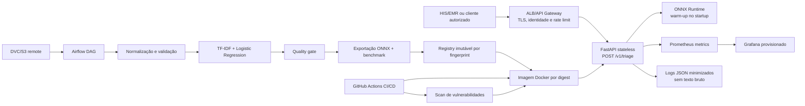

# Diagrama da arquitetura

## Limites da entrega

- O Compose local substitui ALB, AWS, S3 e observabilidade gerenciada somente para
  desenvolvimento.
- O corpus Medical Abstracts TC é técnico e temático; não representa `normal`, `atencao` ou
  `urgente`.
- Promoção clínica exige `urgency_label`, quality gate aprovado e aprovações institucionais.
- Rollback aponta para digest anterior; nenhum fluxo usa `latest`.
