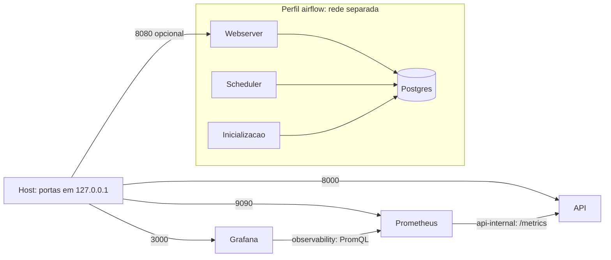

# Decisoes operacionais

## Execucao

A API usa inferencia real-time sincrona: o modelo e carregado uma vez no startup e cada requisicao
recebe resposta imediata. Treino e avaliacao pertencem ao fluxo batch offline e nao participam do
caminho HTTP.

## Topologia local

O comando padrao `docker compose up -d --build --wait` inicia API, Prometheus e Grafana.
O build gera o modelo sintetico dentro da imagem da API. Airflow/Postgres pertencem ao perfil
opcional `airflow`; treino e registro de artefatos continuam separados da inferencia.

API e Prometheus compartilham `api-internal`, uma rede bridge interna de coleta. A API
tambem usa `api-access` para sua porta local publicada. Prometheus e Grafana compartilham
`observability`; Grafana nao compartilha rede com a API. Airflow usa `airflow-backend` interna
e somente seu webserver participa de `airflow-access`. Essa separacao segue as conexoes
explicitas de servicos nas [redes do Compose](https://docs.docker.com/reference/compose-file/networks/).

Prometheus persiste series em `prometheus-data`; Grafana persiste seu banco em `grafana-data`.
Configuracoes e dashboard sao montados somente para leitura. O Airflow possui volumes proprios
para banco, logs, execucoes e registro de modelos, sem montar esses outputs na API. A promocao
do modelo servido continua exigindo uma nova imagem/deploy; um retreino nao troca o modelo
carregado automaticamente.

Prometheus inicia quando o processo da API esta rodando para poder observar readiness degradada.
Grafana aguarda o healthcheck do Prometheus. No perfil opcional, scheduler/webserver dependem
da inicializacao concluida e o webserver tambem aguarda o scheduler saudavel. Essas condicoes
usam as [dependencias e healthchecks do Compose](https://docs.docker.com/compose/how-tos/startup-order/).
O perfil inicia DAGs pausadas, com schedule manual e sem aprovacao clinica automatica.

[compose-local.md](compose-local.md) documenta portas, credenciais locais, volumes, comandos e
o smoke que cria um projeto temporario, verifica a stack e recria Grafana com persistencia.
A execucao verde publicada do dashboard e a verificacao pendente das alteracoes atuais sao
identificadas separadamente nesse guia.

## AWS alvo

A topologia alvo usa ECR para imagens por digest, ECS/Fargate para a API, ALB para TLS, identidade
e health checks, S3 para artefatos e DVC, e observabilidade gerenciada quando aplicavel. O Compose
local e somente ambiente de desenvolvimento; operacao e validacao estao em
[compose-local.md](compose-local.md).

## Identidade, transporte e limites

- Em producao, o ALB/gateway termina TLS e encaminha identidade de servico autenticada.
- A API nao aceita texto de origem desconhecida; o gateway deve aplicar autenticacao, autorizacao,
  rate limiting e allowlist de rotas.
- O contrato da API limita cada texto a 10.000 caracteres e cada lote a 32 instancias.
- O ambiente local nao e uma fronteira de seguranca e nao deve receber dados hospitalares.
- Timeouts, rate limits e cabecalhos de identidade devem ser configurados no gateway antes do deploy.

## Health, startup e rollback

`/health/live` somente verifica o processo. `/health/ready` confirma modelo e preprocessador
carregados no startup. Falha de artefato deixa readiness degradada e retorna `MODEL_UNAVAILABLE`.
Deploy deve aguardar readiness antes de receber trafego e manter o digest anterior para rollback.

## Configuracao

Caminhos de artefatos podem ser definidos por `TRIAGE_ROOT_DIR`, `TRIAGE_MODEL_PATH` e
`TRIAGE_PREPROCESSOR_PATH`. Nenhuma dessas configuracoes contem segredo.
