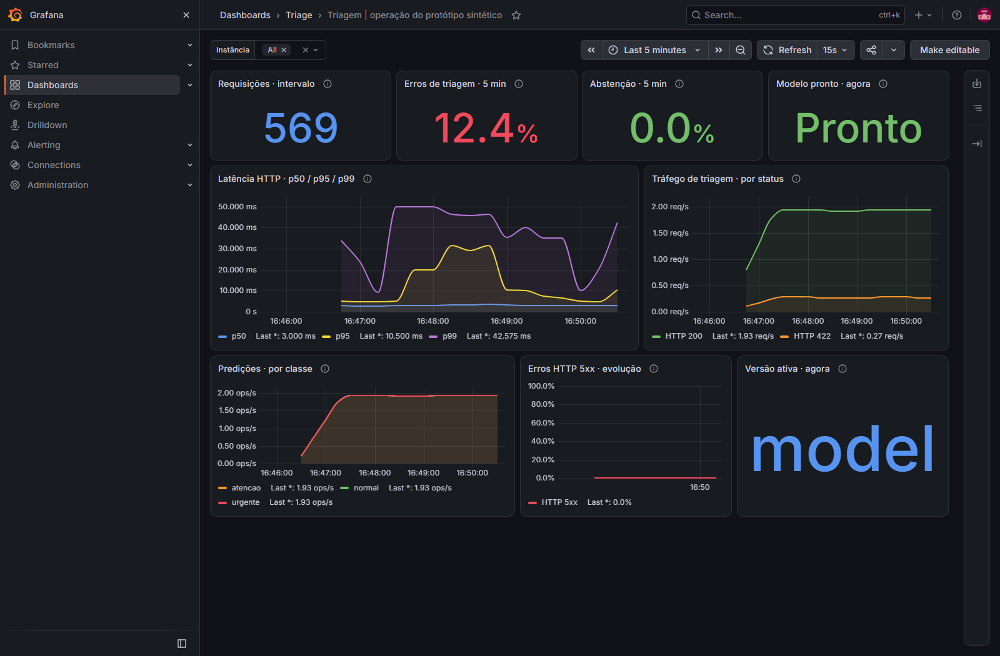

# Grafana local

O Grafana OSS 13.2.4 apresenta as metricas tecnicas da API em um dashboard versionado. Datasource,
pasta e dashboard sao provisionados por arquivos durante o startup, sem importacao manual.
O Prometheus continua responsavel pela coleta e pelas regras de alerta; veja
[prometheus-local.md](prometheus-local.md) e [metrics.md](metrics.md).

## Subir e acessar

Requer Docker com suporte a containers Linux e Compose v2. Na raiz:

```powershell
docker compose config --quiet
docker compose up -d --build --wait --wait-timeout 180
docker compose ps api prometheus grafana
```

Sem perfil adicional, esse comando sobe somente API, Prometheus e Grafana. Airflow/Postgres
pertencem ao perfil opcional `airflow`. O build da API gera o modelo sintetico dentro da imagem,
sem preparar artefatos no host. Portas, configuracao local e ciclo de vida da stack estao em
[compose-local.md](compose-local.md); as URLs deste guia assumem os defaults de `.env.example`.

Abra `http://127.0.0.1:3000` e entre com **usuario `admin` e senha `triage-local-demo`**.
Essas credenciais sao exclusivas da demonstracao local. O Compose permite definir
`GRAFANA_ADMIN_USER` e `GRAFANA_ADMIN_PASSWORD` no ambiente para substituir as credenciais
iniciais. Essa configuracao e
aplicada na criacao do usuario, na primeira inicializacao do banco: alterar a variavel com
`grafana-data` ja preenchido nao redefine a senha de um usuario existente. Consulte a
[configuracao de seguranca do Grafana](https://grafana.com/docs/grafana/latest/setup-grafana/configure-grafana/#security).

Em **Dashboards > Triage**, abra **Triagem | operação do protótipo sintético**. O UID e
`triage-overview`, tambem acessivel
por `http://127.0.0.1:3000/d/triage-overview`. O datasource padrao tem UID `triage-prometheus`
e consulta `http://prometheus:9090` pelo backend do Grafana. Essa URL e interna ao Compose;
o navegador continua acessando os servicos pelas portas locais.

| Configuracao | Valor |
| --- | --- |
| Grafana | `grafana/grafana:13.2.4`, porta `127.0.0.1:3000`. |
| Rede | `observability`, compartilhada somente com Prometheus, separada da API e do Airflow. |
| Banco e estado do Grafana | Volume nomeado `grafana-data` em `/var/lib/grafana`. |
| Provisionamento | `grafana/provisioning` montado em `/etc/grafana/provisioning`, somente leitura. |
| Dashboard | `grafana/dashboards` montado em `/var/lib/grafana/dashboards`, somente leitura. |
| Autenticacao | Login obrigatorio; acesso anonimo e cadastro de usuarios desativados. |

O Compose tambem desativa telemetria, verificacoes de atualizacao e downloads automaticos de
plugins; os paineis usam recursos incluidos no Grafana. As portas da stack escutam somente em
loopback e essa configuracao atende ao desenvolvimento local.

## Ler os paineis

O dashboard abre os ultimos **15 minutos**, atualiza a cada **15 segundos** e permite selecionar
uma ou mais instancias pelo filtro **Instancia**. As consultas usam `job="triage-api"` e os
labels tecnicos limitados da instrumentacao.
Requisicoes e denominadores de erro usam `POST /v1/triage`; endpoints de health e os scrapes de `/metrics`
nao entram nesses paineis. Latencias sao observadas por requisicao/lote, nao por texto.

| Medida | Interpretacao |
| --- | --- |
| Requisicoes de triagem no intervalo | Quantidade na janela selecionada; pode ser fracionaria pela extrapolacao de `increase()`. |
| Erros de triagem em 5 minutos | `triage_prediction_errors_total` dividido pelas requisicoes de triagem: inclui validacao 422, modelo indisponivel e falha de inferencia. |
| Abstencao em 5 minutos | Resultados abstidos divididos pelo total de predicoes entre as instancias selecionadas. |
| Modelo pronto agora | Pronto somente quando todos os alvos selecionados estao UP e possuem alguma versao com readiness igual a um; `unknown=0` e ignorado. |
| Latencia HTTP p50, p95 e p99 | Quantis do histograma em segundos; janela adaptativa `$__rate_interval`, com minimo de um minuto. |
| Trafego de triagem por status | Requisicoes por segundo, incluindo status 4xx e 5xx, na janela adaptativa. |
| Predicoes por classe | Resultados por segundo para `normal`, `atencao` e `urgente`, incluindo resultados com abstencao. |
| Evolucao de erros HTTP 5xx | Fracao 5xx ao longo do tempo na janela adaptativa; zero com trafego sem erros e sem amostras quando ocioso. |
| Versao ativa agora | Versoes com readiness igual a um e scrape UP; nenhuma versao pronta resulta em ausencia de modelo. |

A taxa de erros de triagem segue o contador de erros do SDD. O painel HTTP 5xx acompanha as falhas
do servico, alinhado ao alerta Prometheus; rejeicoes 422 aparecem na taxa de triagem e no trafego
por status, sem alimentar o alerta HTTP 5xx.

As taxas respeitam resets de contadores. Um lote valido com tres textos aumenta requisicoes em
um e predicoes em tres; por isso o denominador de abstencao usa predicoes. Razoes sem trafego
podem aparecer sem dados e precisam ser interpretadas junto da disponibilidade do alvo.
As taxas agregam as instancias selecionadas; as regras de alerta do Prometheus preservam cada
alvo e, na abstencao, a versao de modelo. Use o filtro ao investigar um alvo especifico.
Readiness e abstencao sao sinais tecnicos do prototipo, sem significado de aprovacao clinica.

Para produzir trafego, execute somente exemplos sinteticos em outro terminal:

```powershell
$syntheticBody = '{"instances":[{"report_text":"synthetic baseline stable alpha"},{"report_text":"synthetic review attention delta"},{"report_text":"synthetic priority urgent eta"}]}'
1..12 | ForEach-Object {
    Invoke-RestMethod http://127.0.0.1:8000/v1/triage -Method Post -ContentType application/json -Body $syntheticBody | Out-Null
    Start-Sleep -Seconds 5
}
```

Aguarde pelo menos dois scrapes do Prometheus, com trafego entre eles. Ajuste a janela do
dashboard para incluir o periodo da carga e atualize a pagina. Graficos vazios imediatamente
apos o startup podem refletir falta de amostras; um alvo DOWN deve ser investigado em
`http://127.0.0.1:9090/targets`.

## Verificar o provisionamento

O checker [scripts/check_grafana.py](../scripts/check_grafana.py) verifica o Grafana em execucao,
o datasource e o dashboard provisionados e a execucao das consultas. Use as mesmas credenciais
do banco local; elas sao lidas pelas variaveis `GRAFANA_ADMIN_USER` e `GRAFANA_ADMIN_PASSWORD`.
O checker standalone nao carrega `.env`: se personalizou as credenciais nesse arquivo, exporte
os mesmos valores no terminal. Com os defaults da demonstracao:

```powershell
uv sync --locked --extra dev
$env:GRAFANA_ADMIN_USER = "admin"
$env:GRAFANA_ADMIN_PASSWORD = "triage-local-demo"
uv run --no-sync python scripts/check_grafana.py --base-url http://127.0.0.1:3000 --prometheus-url http://prometheus:9090 --output reports/ci/grafana-smoke.json
```

`--base-url` e o endereco do Grafana acessivel pelo checker no host. `--prometheus-url` e o
endereco esperado **na configuracao do datasource**, acessivel pelo backend do Grafana; no
Compose ele usa o nome de servico `prometheus`. O checker aceita respostas sem amostras quando
nao ha trafego: ele confirma a execucao das consultas sem erro, enquanto a carga sintetica e a
inspecao visual confirmam a apresentacao dos dados. O relatorio grava somente evidencia tecnica,
sem senha ou texto de entrada. Para validar tambem a criacao dos containers, API, scrape e
recriacao do Grafana com persistencia, use `scripts/check_compose.py`, descrito em
[compose-local.md](compose-local.md#validacao-integrada). A CI executa essa validacao no job
`monitoring`; veja [ci.md](ci.md).

## Alterar e preservar

Edite o JSON em [grafana/dashboards/triage-overview.json](../grafana/dashboards/triage-overview.json)
e revise as consultas junto com os testes. O dashboard provisionado nao permite salvar edicoes
pela UI. O datasource fica em [prometheus.yml](../grafana/provisioning/datasources/prometheus.yml)
e o provider em [triage.yml](../grafana/provisioning/dashboards/triage.yml); os UIDs estaveis conectam o
dashboard ao datasource sem depender de IDs gerados no banco. Esse comportamento segue o
[provisionamento por arquivos do Grafana](https://grafana.com/docs/grafana/latest/administration/provisioning/).

Apos alterar os arquivos de provisionamento, execute `docker compose restart grafana` e rode
o checker novamente. Mudancas no Compose exigem `docker compose up -d grafana` para recriar
o servico quando necessario. O JSON montado continua sendo a fonte versionada do dashboard.
O provider verifica alteracoes no JSON a cada 30 segundos, por polling compativel com bind mounts.

Para parar os tres servicos sem apagar os dados:

```powershell
docker compose stop api prometheus grafana
```

O banco persiste em `grafana-data`; as series temporais continuam no volume do Prometheus,
com os limites descritos no [guia do coletor](prometheus-local.md#retencao-e-armazenamento).
`docker compose down -v` apaga os volumes do projeto, incluindo os bancos Grafana e Postgres
do Airflow e o historico Prometheus.

## Captura do dashboard

Captura real do Grafana OSS 13.2.4 em 22/10/2026, com trafego exclusivamente sintetico e janela
de cinco minutos. Os valores ilustram a demonstracao local, sem representar benchmark ou
validacao clinica. Os erros de triagem incluem as rejeicoes 422 geradas no smoke.



## Validacao local de 22/10/2026

Grafana OSS 13.2.4 e Prometheus 3.13.3 foram executados como binarios oficiais para Windows,
com checksums conferidos, junto da API Uvicorn e modelo sintetico. O banco Grafana foi criado
vazio, e o datasource e dashboard foram carregados automaticamente pelos arquivos versionados.
Somente portas, URL do datasource e caminho de leitura do dashboard foram adaptados para os
processos nativos temporarios.

- Checker real: health, datasource somente leitura, health do datasource, dashboard provisionado
  e as onze consultas dos nove paineis aprovados.
- As onze consultas retornaram amostras reais do trafego sintetico; scrape da API com `up=1`.
- Captura renderizada em Chromium headless, 1600 x 1050, sem erros de JavaScript no frontend.
- Pytest: 230 testes aprovados, sem skips, com 85% de cobertura da aplicacao e scripts; 51 testes
  novos verificam o checker, incluindo falhas de provisionamento, consultas e autenticacao.
- Ruff, OpenAPI, lockfile, actionlint, configuracao Compose e os onze cenarios promtool aprovados.

Relatorios locais em `reports/ci/grafana-smoke.json`, `grafana-native-evidence.json` e
`grafana-render.json`, ignorados pelo Git. Os processos temporarios foram encerrados ao final.
O commit publicado `6f562a6` tambem passou a inicializacao da stack por Compose e o checker das
onze consultas dos nove paineis no
[GitHub Actions, execucao 39865208559](https://github.com/ebianchini/tech-challenge-fase-3/actions/runs/39865208559),
comprovando o provisionamento automatico do dashboard nessa versao.
O [registro versionado](evidence/grafana-compose-ci.json) conserva commit, job e relatorio do
artefato; as consultas do checker aceitam resultados vazios, portanto essa evidencia remota
nao demonstra trafego nem incrementos das metricas.

Docker nao esta instalado nesta maquina. A reorganizacao posterior de redes/perfis, o build
do modelo dentro da imagem e o novo smoke com recriacao do Grafana ainda precisam de uma execucao
do commit atualizado em Docker. [compose-local.md](compose-local.md#validacao-integrada) descreve
a verificacao e distingue essa pendencia da evidencia do baseline publicado.
